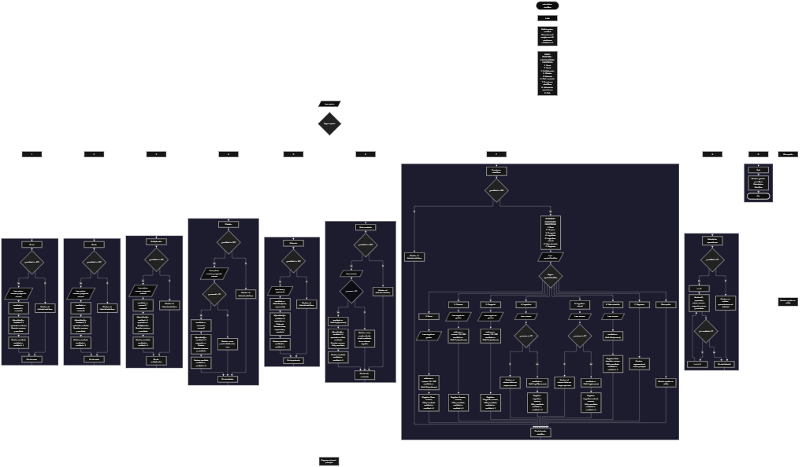

Este proyecto, llamado <b>calculadora científica</b>, fue desarrollado en <b>visual basic .net</b> como un ejercicio práctico para fortalecer la lógica de programación mediante la creación de una calculadora de consola. El programa cuenta con un menú principal de nueve opciones que permite realizar operaciones matemáticas como <b>suma, resta, multiplicación, división, potencia, raíz cuadrada y funciones científicas</b>, además de consultar el historial de operaciones realizadas. Cada operación almacena información como su identificador, nombre, números utilizados y resultado, mediante arreglos paralelos con una capacidad máxima de <b>10 operaciones durante la ejecución</b>. Durante su desarrollo se aplicaron conceptos fundamentales de programación, como variables, arreglos, estructuras condicionales, ciclos repetitivos y estructuras de selección, junto con métodos matemáticos de la biblioteca <b>math</b>. Este proyecto permite poner en práctica los conocimientos adquiridos en Visual Basic .NET y comprender cómo desarrollar aplicaciones matemáticas que procesan y almacenan resultados temporalmente.

<h2 align="center">⚙️ Funcionamiento del menú principal</h2>

### ➕ Suma

La opción <b>1) suma</b> permite realizar la adición de dos números introducidos por el usuario. Antes de comenzar, el programa comprueba que la cantidad de operaciones almacenadas sea menor que la capacidad máxima de los arreglos mediante la condición <b>cantidad &gt;= ids.length</b>. Si el historial está lleno, muestra el mensaje <b>"el historial está lleno."</b>. Si existe espacio disponible, solicita el primer y segundo número, calcula la suma mediante el operador <b>+</b> y almacena el identificador, el nombre de la operación, los dos números utilizados y el resultado en sus respectivos arreglos. Finalmente, muestra el resultado obtenido y aumenta la variable <b>cantidad</b> en uno.

### ➖ Resta

La opción <b>2) resta</b> permite calcular la diferencia entre dos números. Primero, el programa verifica que exista espacio disponible en el historial. Si se alcanzó la capacidad máxima, muestra el mensaje <b>"el historial está lleno."</b>. En caso contrario, solicita el primer y segundo número, realiza la operación mediante el operador <b>-</b> y almacena los datos correspondientes en los arreglos <b>ids, operaciones, primerosNumeros, segundosNumeros y resultados</b>. Después, muestra el resultado de la resta y aumenta la variable <b>cantidad</b> en uno para actualizar el número de operaciones registradas.

### ✖️ Multiplicación

La opción <b>3) multiplicación</b> permite obtener el producto de dos números introducidos por el usuario. Antes de realizar el cálculo, el programa comprueba que el historial no haya alcanzado su capacidad máxima. Si existe espacio disponible, solicita ambos números y utiliza el operador <b>*</b> para calcular el resultado. Posteriormente, registra el identificador de la operación, su nombre, los números utilizados y el resultado en los arreglos correspondientes. Finalmente, muestra el resultado en pantalla e incrementa la variable <b>cantidad</b> en uno. Si el historial está lleno, impide realizar una nueva operación y muestra el mensaje correspondiente.

### ➗ División

La opción <b>4) división</b> permite dividir un número entre otro. Primero, el programa comprueba que exista espacio disponible en el historial y solicita el primer y segundo número. Antes de realizar la división, verifica que el segundo número sea diferente de cero mediante la condición <b>numero2 = 0</b>. Si el divisor es cero, muestra el mensaje <b>"no se puede dividir entre cero."</b> y no registra la operación. Si el divisor es válido, realiza la división mediante el operador <b>/</b>, almacena los datos y el resultado en los arreglos correspondientes, muestra el valor calculado y aumenta la variable <b>cantidad</b> en uno.

### 🔢 Potencia

La opción <b>5) potencia</b> permite elevar un número a una determinada potencia. El programa comprueba primero que exista espacio disponible en el historial. Después, solicita la <b>base</b> y el <b>exponente</b> que se utilizarán en el cálculo. Para obtener el resultado, utiliza el método <b>math.pow(numero1, numero2)</b>, que calcula la base elevada al exponente indicado. Una vez realizada la operación, almacena el identificador, el nombre de la operación, la base, el exponente y el resultado en sus respectivos arreglos. Finalmente, muestra el resultado y aumenta la variable <b>cantidad</b> en uno.

### √ Raíz cuadrada

La opción <b>6) raíz cuadrada</b> permite calcular la raíz cuadrada de un número introducido por el usuario. Antes de realizar el cálculo, el programa comprueba que exista espacio disponible en el historial. Después, solicita el número y verifica que no sea negativo mediante la condición <b>numero &lt; 0</b>. Si el valor es negativo, muestra el mensaje <b>"no se puede calcular la raíz cuadrada de un número negativo."</b> y no registra la operación. Si el número es válido, utiliza el método <b>math.sqrt(numero)</b> para calcular su raíz cuadrada. Posteriormente, almacena el identificador, el nombre de la operación, el número utilizado y el resultado. Como esta operación utiliza un solo número, guarda el valor <b>"n/a"</b> en el arreglo <b>segundosNumeros</b>. Finalmente, muestra el resultado y aumenta la variable <b>cantidad</b> en uno.

### 🧮 Funciones científicas

La opción <b>7) funciones científicas</b> permite acceder a un submenú que contiene seis operaciones matemáticas adicionales: <b>seno, coseno, tangente, logaritmo, logaritmo natural y valor absoluto</b>. Antes de mostrar este submenú, el programa comprueba que exista espacio disponible en el historial. Cada función solicita el valor necesario, realiza el cálculo utilizando los métodos de la biblioteca <b>math</b> y almacena el identificador, el nombre de la operación, el número utilizado y el resultado en los arreglos correspondientes. Para estas operaciones se utiliza el valor <b>"n/a"</b> en el segundo número, debido a que no requieren un segundo argumento. El submenú también incluye una opción para regresar al menú principal y una validación para las selecciones incorrectas.

#### 📐 Seno

La opción <b>1) seno</b> solicita un ángulo expresado en grados y lo convierte a radianes mediante la fórmula <b>numero * math.pi / 180</b>. Después, utiliza el método <b>math.sin(radianes)</b> para calcular el seno del ángulo. Finalmente, registra el valor original en grados, el nombre de la operación y el resultado obtenido.

#### 📐 Coseno

La opción <b>2) coseno</b> solicita un ángulo en grados y realiza su conversión a radianes utilizando la fórmula <b>numero * math.pi / 180</b>. Posteriormente, utiliza el método <b>math.cos(radianes)</b> para calcular el coseno correspondiente. El programa almacena el ángulo introducido y el resultado en los arreglos del historial.

#### 📐 Tangente

La opción <b>3) tangente</b> solicita un ángulo expresado en grados y lo convierte a radianes mediante la fórmula <b>numero * math.pi / 180</b>. A continuación, utiliza el método <b>math.tan(radianes)</b> para obtener la tangente del ángulo. Después, registra el número utilizado, el nombre de la operación y el resultado calculado en los arreglos correspondientes.

#### 📊 Logaritmo

La opción <b>4) logaritmo</b> solicita un número y comprueba que sea mayor que cero mediante la condición <b>numero &lt;= 0</b>. Si el valor no cumple esta condición, muestra el mensaje <b>"el número debe ser mayor que cero."</b> y no registra la operación. Si el número es válido, utiliza el método <b>math.log10(numero)</b> para calcular el logaritmo en base 10. Finalmente, almacena los datos de la operación y muestra el resultado obtenido.

#### 📈 Logaritmo natural

La opción <b>5) logaritmo natural</b> permite calcular el logaritmo natural de un número. Primero, solicita el valor y comprueba que sea mayor que cero. Si el número es menor o igual a cero, muestra el mensaje <b>"el número debe ser mayor que cero."</b>. En caso contrario, utiliza el método <b>math.log(numero)</b>, que calcula el logaritmo natural en base <b>e</b>. Después, almacena el número utilizado, el nombre de la operación y el resultado en los arreglos correspondientes.

#### ➕ Valor absoluto

La opción <b>6) valor absoluto</b> solicita un número y utiliza el método <b>math.abs(numero)</b> para obtener su valor absoluto, es decir, su distancia respecto al cero sin considerar el signo. El programa registra el número original, el nombre de la operación y el resultado obtenido. Finalmente, muestra el valor absoluto calculado y actualiza la cantidad de operaciones almacenadas.

#### 🚪 Regresar al menú principal

La opción <b>7) regresar</b> permite abandonar el submenú de funciones científicas y volver al menú principal de la calculadora. Para ello, muestra el mensaje <b>"regresando al menú principal."</b>. Esta opción no realiza ningún cálculo ni registra información en el historial.

### 📋 Historial de operaciones

La opción <b>8) historial de operaciones</b> permite consultar todas las operaciones realizadas y almacenadas durante la ejecución del programa. Primero, comprueba si la variable <b>cantidad</b> es igual a cero. Si no existen operaciones registradas, muestra el mensaje <b>"no existen operaciones en el historial."</b>. En caso contrario, utiliza un ciclo <b>for...next</b> para recorrer los arreglos desde la primera posición hasta <b>cantidad - 1</b>. Durante el recorrido, muestra el identificador, el nombre de la operación, el primer número, el segundo número y el resultado correspondiente a cada registro. De esta manera, el usuario puede consultar los cálculos realizados sin necesidad de repetir las operaciones.

### 🚪 Salir del menú principal

La opción <b>9) salir</b> permite finalizar la ejecución de la calculadora y muestra el mensaje <b>"gracias por utilizar calculadora científica."</b>. El menú principal se encuentra dentro de una estructura repetitiva <b>do...loop while</b>, que mantiene el programa en funcionamiento mientras la variable <b>opcion</b> sea diferente de <b>9</b>. Cuando el usuario selecciona esta opción, la condición del ciclo se cumple y el programa finaliza correctamente.

<h2 align="center">🧠 Temas aplicados en el proyecto</h2>

### 📦 Variables

En este proyecto se utilizan variables para almacenar los números introducidos por el usuario, controlar la cantidad de operaciones realizadas, guardar los resultados de los cálculos y administrar las opciones de los menús. Cada variable cumple una función específica dentro de las operaciones matemáticas y del registro del historial.

🔢 **Ids:** Almacena los identificadores asignados a cada operación registrada.

🧮 **Operaciones:** Guarda el nombre de la operación matemática realizada.

🔢 **PrimerosNumeros:** Almacena el primer número o argumento utilizado en cada operación.

🔢 **SegundosNumeros:** Almacena el segundo número utilizado o el texto "N/A" cuando la operación necesita un solo valor.

📊 **Resultados:** Guarda los resultados obtenidos en los diferentes cálculos.

📈 **Cantidad:** Controla el número de operaciones almacenadas en el historial.

🎯 **Opcion:** Almacena la opción seleccionada por el usuario en el menú principal.

🧭 **OpcionCientifica:** Almacena la opción seleccionada en el submenú de funciones científicas.

### 🗃️ Arreglos

En este proyecto se utilizan cinco arreglos paralelos con una capacidad de <b>10 posiciones</b> cada uno. Todos utilizan el mismo índice para relacionar la información correspondiente a una misma operación. Por ejemplo, los datos de una operación almacenada en la posición <b>0</b> se encuentran distribuidos entre <b>ids[0], operaciones[0], primerosNumeros[0], segundosNumeros[0] y resultados[0]</b>. Esta organización permite registrar y consultar las operaciones de manera ordenada durante la ejecución del programa.

🆔 **Ids[10]:** Almacena los identificadores de las operaciones registradas.

🧮 **Operaciones[10]:** Almacena los nombres de las operaciones matemáticas.

🔢 **PrimerosNumeros[10]:** Guarda el primer número o argumento utilizado en cada cálculo.

🔢 **SegundosNumeros[10]:** Guarda el segundo número de las operaciones o el valor "N/A" cuando no corresponde.

📊 **Resultados[10]:** Almacena los resultados obtenidos en cada operación.

### 🔀 Estructuras condicionales

En este proyecto se utiliza la estructura <b>if...else</b> para comprobar si el historial dispone de espacio antes de realizar una operación, verificar que el divisor sea diferente de cero, impedir el cálculo de raíces cuadradas con números negativos y comprobar que los valores utilizados en los logaritmos sean mayores que cero. También permite determinar si existen operaciones registradas antes de mostrar el historial. Estas condiciones ayudan a controlar los cálculos y evitar determinadas operaciones matemáticas no válidas.

### 🔄 Estructuras repetitivas

En este proyecto se utilizan las estructuras <b>do...loop while</b> y <b>for...next</b>. El ciclo <b>do...loop while</b> mantiene activo el menú principal y permite que el usuario seleccione diferentes operaciones hasta elegir la opción de salida. Por otro lado, el ciclo <b>for...next</b> se utiliza en el historial para recorrer los arreglos y mostrar todos los registros almacenados desde la primera posición hasta la última operación realizada.

### 🎯 Estructura select case

El programa utiliza la estructura <b>select case</b> para evaluar el valor almacenado en la variable <b>opcion</b> y ejecutar la operación correspondiente del menú principal. Cada caso representa una función de la calculadora, desde las operaciones aritméticas hasta las funciones científicas y la consulta del historial. También utiliza un bloque <b>case else</b> para mostrar el mensaje <b>"opción no válida."</b> cuando el usuario introduce una selección que no corresponde a las opciones disponibles. Dentro de las funciones científicas se implementa una segunda estructura <b>select case</b> controlada por la variable <b>opcionCientifica</b>.

### 🔢 Dimensionamiento de arreglos

El programa utiliza arreglos declarados con diez posiciones mediante la instrucción <b>dim</b>. Se definieron cinco arreglos con capacidad para almacenar hasta <b>10 operaciones</b> durante la ejecución. La variable <b>cantidad</b> controla cuántas posiciones están ocupadas y permite comprobar la disponibilidad de espacio antes de registrar una nueva operación. Cuando se alcanza la capacidad máxima, el programa impide realizar nuevos registros.

### 🧮 Operaciones matemáticas

El proyecto utiliza operadores aritméticos y métodos de la biblioteca <b>math</b> para realizar diferentes cálculos. Los operadores <b>+, -, * y /</b> permiten efectuar las operaciones básicas de suma, resta, multiplicación y división. Para las operaciones avanzadas se utilizan los métodos <b>math.pow()</b>, <b>math.sqrt()</b>, <b>math.sin()</b>, <b>math.cos()</b>, <b>math.tan()</b>, <b>math.log10()</b>, <b>math.log()</b> y <b>math.abs()</b>. Estos recursos permiten ampliar las capacidades de la calculadora y trabajar con diferentes funciones matemáticas.

### 🔄 Conversión de datos

El programa utiliza los métodos <b>convert.toint32()</b> y <b>convert.todouble()</b> para convertir los datos introducidos mediante <b>console.readline()</b> a los tipos numéricos necesarios. También utiliza el método <b>tostring()</b> para convertir el segundo número de cada operación en una cadena de texto antes de almacenarlo en el arreglo <b>segundosNumeros</b>. Esto permite guardar tanto valores numéricos como el texto <b>"n/a"</b> dentro del mismo arreglo.

### 🗂️ Registro de operaciones

Cada vez que se realiza correctamente una operación, el programa almacena su información en la posición indicada por la variable <b>cantidad</b>. El identificador se genera utilizando la expresión <b>cantidad + 1</b> y los demás datos se guardan en los arreglos paralelos. Después de completar el registro, la variable <b>cantidad</b> aumenta en uno. Este procedimiento permite mantener organizadas las operaciones y recuperar sus datos posteriormente mediante la opción de historial.

<h2 align="center">¿Cómo se implementó el registro y la consulta de operaciones?</h2>

En este proyecto se implementaron procesos de <b>registro y consulta</b> para administrar las operaciones matemáticas realizadas. El registro se lleva a cabo cuando el usuario selecciona cualquiera de las operaciones disponibles y el programa almacena el identificador, el nombre de la operación, los números utilizados y el resultado en los arreglos correspondientes. La consulta se realiza mediante la opción <b>historial de operaciones</b>, que recorre los registros almacenados y muestra toda su información. A diferencia de un sistema de gestión CRUD, esta calculadora no incluye funciones para editar o eliminar operaciones del historial; los registros permanecen disponibles únicamente durante la ejecución del programa.

<h2 align="center">Diagrama de flujo del proyecto</h2>

<h2 align="center">🛡️ Validaciones del programa</h2>

### 📭 No existen operaciones registradas

Esta validación se utiliza en la opción <b>8) historial de operaciones</b>. El programa comprueba si la variable <b>cantidad</b> es igual a <b>0</b>. Si no existen operaciones almacenadas, muestra el mensaje <b>"no existen operaciones en el historial."</b> y evita realizar el recorrido de los arreglos. Si existen registros, muestra la información de todas las operaciones realizadas.

### ⚠️ Historial lleno

Esta validación se utiliza antes de realizar las operaciones matemáticas de los menús principales. El programa comprueba si la variable <b>cantidad</b> es mayor o igual a la capacidad de los arreglos mediante la condición <b>cantidad &gt;= ids.length</b>. Si el historial está lleno, muestra el mensaje <b>"el historial está lleno."</b> e impide registrar una nueva operación. Si existe espacio disponible, permite continuar con el cálculo y almacenar el resultado correspondiente. Esta comprobación también se realiza antes de ingresar al submenú de funciones científicas.

### ➗ División entre cero

Esta validación se utiliza en la operación de división. Después de solicitar el primer y segundo número, el programa comprueba si el divisor es igual a <b>0</b>. Si se cumple esta condición, muestra el mensaje <b>"no se puede dividir entre cero."</b> y no realiza el cálculo ni registra la operación. Si el divisor es diferente de cero, continúa con la división y almacena el resultado en el historial.

### √ Raíz cuadrada de un número negativo

Esta validación se utiliza en la opción de raíz cuadrada. El programa comprueba si el número introducido es menor que <b>0</b> mediante la condición <b>numero &lt; 0</b>. Si el valor es negativo, muestra el mensaje <b>"no se puede calcular la raíz cuadrada de un número negativo."</b> y no registra la operación. Si el número es mayor o igual a cero, utiliza el método <b>math.sqrt()</b> para calcular la raíz cuadrada y almacenar el resultado.

### 📊 Logaritmo no válido

Esta validación se utiliza en las opciones de logaritmo y logaritmo natural. El programa comprueba si el número introducido es menor o igual a <b>0</b>. Si se cumple esta condición, muestra el mensaje <b>"el número debe ser mayor que cero."</b> y no realiza el cálculo. Si el valor es positivo, utiliza los métodos <b>math.log10()</b> o <b>math.log()</b>, según la operación seleccionada, y registra el resultado en el historial.

### ⚠️ Opción inválida

El menú principal y el submenú de funciones científicas utilizan la estructura <b>select case</b> con un bloque <b>case else</b>. Cuando el usuario introduce un número que no corresponde a ninguna de las opciones disponibles, el programa muestra el mensaje <b>"opción no válida."</b>. Esta comprobación permite informar sobre las selecciones incorrectas sin ejecutar una operación diferente a la solicitada.

### 🔢 Entrada numérica

El programa utiliza los métodos <b>convert.toint32()</b> y <b>convert.todouble()</b> para convertir las entradas del usuario a valores numéricos. Sin embargo, el código actual no incluye un manejo de excepciones para controlar entradas vacías o datos que no sean numéricos. Por este motivo, si se introduce un valor que no puede convertirse, el programa puede finalizar inesperadamente.

### 📐 Ángulos de funciones trigonométricas

En las funciones de seno, coseno y tangente, el programa solicita los ángulos en grados y los convierte a radianes antes de realizar los cálculos. Esta conversión permite utilizar correctamente los métodos trigonométricos de la biblioteca <b>math</b>. Sin embargo, el código actual no incluye una validación especial para los ángulos en los que la tangente no está definida matemáticamente.

<h2 align="center">🎯 Objetivo del proyecto</h2>

El objetivo principal de este proyecto es fortalecer la <b>lógica de programación</b> mediante el desarrollo de una calculadora científica en <b>visual basic .net</b>. A través de su construcción se busca aplicar los conocimientos adquiridos sobre variables, arreglos, estructuras condicionales, ciclos repetitivos y estructuras de selección, integrándolos con operadores y métodos matemáticos para resolver diferentes cálculos. Además, el proyecto permite comprender cómo registrar y consultar resultados mediante arreglos paralelos, estableciendo una base para desarrollar aplicaciones matemáticas y sistemas más completos con otros lenguajes y tecnologías.

